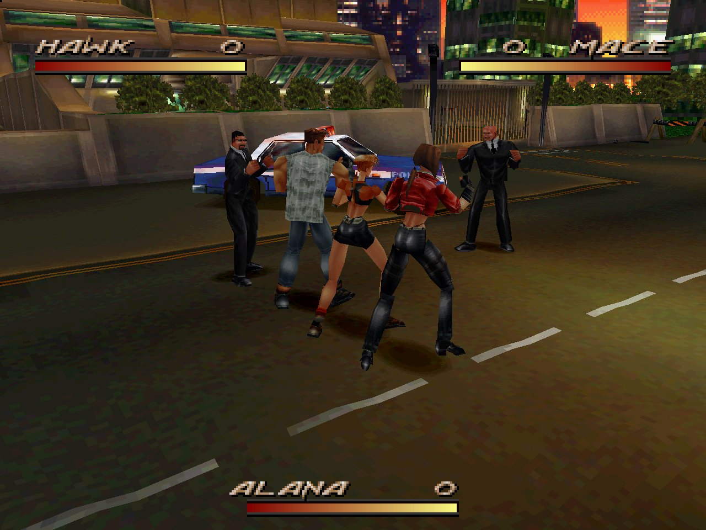
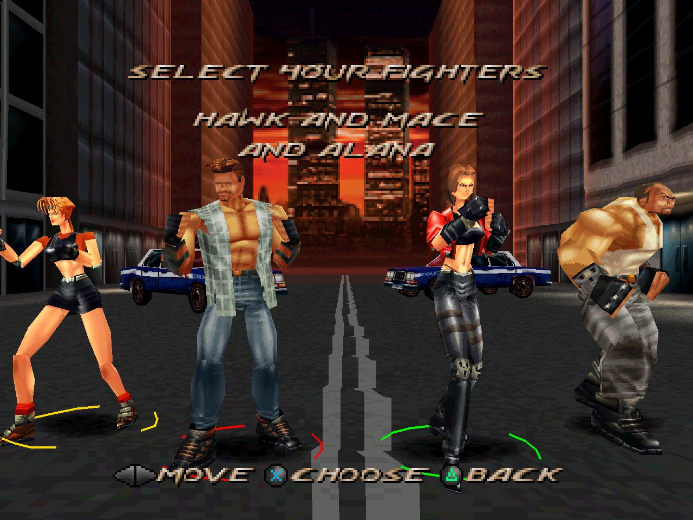
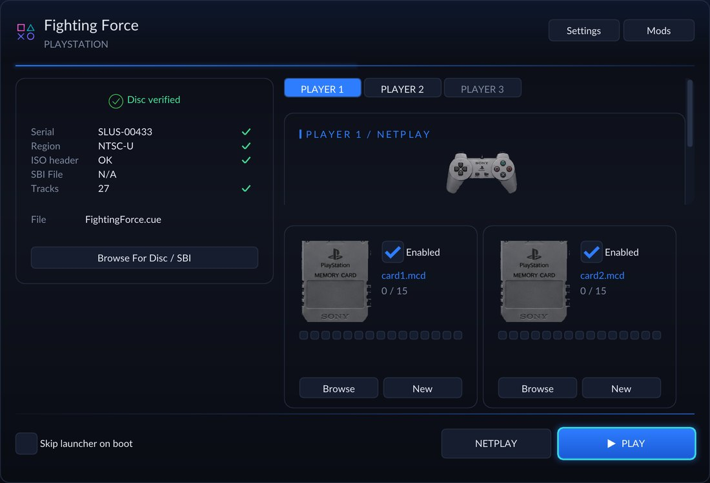
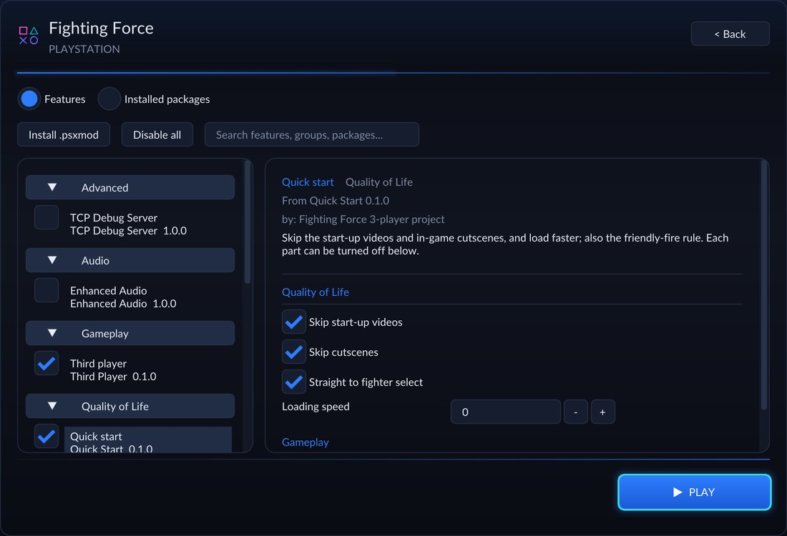

# Fighting Force — Recompiled

*Fighting Force* is a 3D beat 'em up for the original Sony PlayStation
(PS1), made by Core Design and published by Eidos Interactive in 1997. This
unofficial fan project turns that PlayStation game into a native program for
Windows and macOS.

It also adds something the original never had: **a third simultaneous
player**. The original game has four fighters (Hawk, Mace, Smasher and
Alana) but only two players. Here three players each pick a different
fighter and play the campaign together, on one PC or on three PCs over a
LAN.



**This repository holds no game data and no game code.** You need your own
copy of the PlayStation disc *Fighting Force (USA)* (SLUS-00433): one `.cue`
file and all 27 `.bin` tracks (the Redump layout). Every build is made from
that disc.

| | |
|---|---|
| Original game | *Fighting Force*, Sony PlayStation (PS1), 1997 |
| Genre | 3D beat 'em up |
| Original developer | Core Design |
| Original publisher | Eidos Interactive |
| Players | 3 (1 or 2 in the original game) |
| Disc used | PlayStation, USA (SLUS-00433) |
| This port | Windows and macOS (Windows not tested yet, see [Known limits](#known-limits)) |

- Players' guide (first start, matches over Radmin VPN, saves, what to send
  when something goes wrong): [`docs/PLAYING_TOGETHER.md`](docs/PLAYING_TOGETHER.md)
- What changed in each version: [`CHANGELOG.md`](CHANGELOG.md)

## About the original game

*Fighting Force* came out on the PlayStation in November 1997, in North
America and in Europe. A Windows PC version came out in Europe in October
1997. Crave Entertainment released *Fighting Force 64* for the Nintendo 64
in 1999. In Japan the PlayStation game was released as *Metal Fist* (1998).

Core Design first offered the game to Sega as a possible fourth *Streets of
Rage* game. Sega said no, and Core made it a game of its own. A sequel,
*Fighting Force 2*, followed in 1999.

**The story.** Dr. Dex Zeng, a criminal mastermind with his own army,
predicted that the world would end in the year 2000. When it did not, he set
out to destroy it himself. Four fighters go after him:
- Hawk Manson;
- Mace Daniels;
- Ben "Smasher" Jackson;
- Alana McKendricks.

The fight starts at the police cordon around Zeng's office tower. It goes
through a shopping mall, the subway and a Coast Guard base, and ends at his
island headquarters.

**How it plays.**
- One or two players each pick one of the four fighters. With two players,
  both share one screen and one camera.
- The levels are 3D city and science-fiction places, with waves of
  enemies.
- Hawk and Mace are all-rounders. Smasher is slow and strong, and Alana is
  fast.
- Much of the scenery can be smashed. Things lying around become weapons:
  soda cans, knives, guns. Smasher can even lift and throw a car engine.
- Each fighter has a special move that costs some of their health.
- At some points the players choose which way to go.

The release facts are from [Wikipedia's *Fighting Force*
article](https://en.wikipedia.org/wiki/Fighting_Force). The player count and
the shared camera were checked on the USA disc.

## What this project is

- **A recompilation, not an emulator reading the disc's program.** The
  static recompiler [PSXRecomp](https://github.com/RetroPortingToolKit/psxrecomp)
  takes the game's PlayStation program (MIPS R3000A machine code) from your
  disc and translates it into C ahead of time. A normal C compiler then
  makes a native program for your PC from that C. Code the recompiler did
  not find ahead of time runs in a built-in interpreter.
- **The PlayStation's hardware is still emulated.** The game's code expects
  a PS1's graphics chip, sound chip, CD drive and controllers, so the
  PSXRecomp runtime provides them. The pictures, sound and music come from
  your disc.
- **No Sony BIOS is needed.** The game runs on the bundled open-source
  OpenBIOS.
- **The launcher** is [recomp-ui](https://github.com/RetroPortingToolKit/recomp-ui):
  controllers, settings, mods and the online room.
- **What this repository holds:**
  - the recompiler's inputs for this game: config, function list and symbol
    names;
  - the source of the two mods, the third player and Quick Start;
  - the build, setup and test tools, and the docs;
  - the framework and the launcher, as git submodules.
- **What it does not hold:** the disc, the generated C and the compiled
  game. Your build makes them from your own disc on your own PC.

## What the mods add

The game comes with two mods of this project. Both are **on by default**. You
find them in the launcher under **Mods**, where each mod and each of its
options can be switched off. Online, the host's and the guests' settings for
these two mods must match, or the match does not start.

### Third player (`ff.third-player`, Mods → Gameplay → Third player)

This mod adds a third fighter to the two-player game. Player 3 has
everything players 1 and 2 have:
- their own fighter on the select screen: the three must be different;
- their own health bar and score (bottom of the screen), continues and
  high-score entry;
- the weapon gift at a level start;
- the START pause, with its own "PAUSED 3P" menu;
- a place in the memory card save.

The camera keeps all three in view, and the enemies attack player 3 like
the others.



**When it is active.** Player 3 plays only when someone joins.
- Online, the match's third seat is player 3.
- On one PC, controller 3 joins on the fighter select with ✕.
- The mod needs a build with 5 controller seats and the multitap on port 2
  (`game_3p.toml`, `build-net`). In the stock 2-player build it changes
  nothing except one fix: enemy spawns wait while every enemy slot is taken.
  That fixes a crash of the original game on a later level.

**Options:** none. Player 3's input comes from controller seat 3, the same
synchronised seat input netplay uses, so it is safe online.

**Costs:** a level start loads player 3's fighter textures as well, where the
game has room for them (see [Known limits](#known-limits)).

### Quick Start (`ff.quick-start`, Mods → Quality of Life → Quick Start)

Gets you into the game faster, and holds the friendly-fire rule. Its
options, as the launcher labels them:

| Option | Default | What it does |
|---|---|---|
| Skip start-up videos | on | Skips the Eidos and Core Design logos and the intro film, as pressing START does (about 50 seconds) |
| Skip cutscenes | on | Skips the helicopter scene before the first level, the story scenes between levels and the ending, as pressing ✕ does |
| Straight to fighter select | on | No PRESS START and no 1 / 2 PLAYER GAME menu. Offline, player 1 is in, and players 2 and 3 join with ✕ and leave with △. Online, everyone in the match is in. Player 1's △ opens the original main menu (options, memory card) |
| Loading speed | 0 | How much faster than real time a loading screen may run: 0 = as fast as the PC allows, 1 = authentic. Offline only |
| Friendly fire (heading *Gameplay*) | on | On keeps the original rule: players can hurt each other. Off: a player's punches, kicks, thrown objects, blasts and shots reach only the enemies. Enemies still hit everyone |

Both skips press the game's own skip buttons where the game reads them, so
the game takes its own path and every PC in a match does the same.

### The picture

- **No PS1 dither pattern** by default: the picture is drawn in true
  colour. To bring the pattern back, turn on the framework's *Mods → Image
  Filtering* and set *Dithering → Native (PS1)*.
- **Offline the 3D picture renders at 4x** (the framework's *Internal
  Resolution* mod).
- Picture settings are each player's own, also in a match.

## The launcher

The game opens on the framework's launcher. Its main parts:
- **Controller cards: PLAYER 1, PLAYER 2, PLAYER 3** (the first screen).
  Choose each player's gamepad below the controller picture; **Configure**
  changes its buttons.
  - The first gamepad is player 1 and the second is player 2 by themselves.
  - Player 3's gamepad has to be chosen once; the framework has no
    automatic choice for it.
  - The keyboard works too: arrows, X = ✕, S = ○, Z = □, A = △,
    Return = Start.
  - Online, every PC uses its own PLAYER 1 card.
- **Mods**: the two mods above, under *Gameplay* and *Quality of Life*, plus
  the framework's own (picture, sound, rewind, ...). Click a mod's name to see
  its options.
- **NETPLAY → LAN / Direct IP**: the room for a match.
  - The host chooses **Host Lobby**, sets Max Players to 3 and clicks Create.
  - The others choose **Join Direct** with the host's address and port 7777.
  - The host presses **PLAY** when everyone is seated.
- **PLAY**: starts the game on this PC.





## Known limits

- **Nothing has run on Windows yet.** Every test ran on macOS: the
  automated tests play the real game, and 3-peer matches ran on one Mac with
  simulated lag and packet loss. The Windows start files and the packages
  are untried.
- **No Mac ↔ Windows matches.** They are untested, and the framework does
  not claim that a macOS build and a Windows build stay in step. Matches are
  meant for Windows PCs over Radmin VPN.
- **Player 3 looks wrong in 7 crowded levels** (5, 7, 8, 9, 11, 12, 18).
  The game has room in its texture table and video memory for only two
  fighters' textures there. Elsewhere player 3's fighter is drawn correctly.
  This changes only the look: player 3 plays the same.
- **Matches draw at the native resolution (1x).** Offline the picture is
  4x. Why the Internal Resolution choice does not reach a match is not
  traced.
- **If one player drops out, the match ends for everyone.** Start again and
  load the last checkpoint or save state, which the host keeps.
- **Player 3's START pause needs Quick Start.** The framework lets only one
  mod hook a game function, and the pad read belongs to Quick Start. With
  Quick Start off, player 3's START does nothing.
- **The room chat repeats "<name> has joined."** while guests wait: a
  harmless launcher display bug.

## Playing on Windows

Players get a ZIP from whoever runs the game for them. No ZIP is published
here.
- **The self-building ZIP** (`tools/make_player_zip.py`): no game code in
  it. `Setup.bat` builds the game once from the player's own disc.
- **A ready-built package**: planned, made with `windows/Make_Release.bat`
  (the framework's release packager, `packaging/release.toml`). It contains
  the compiled game, so it is shared privately with friends who own the
  game, never published.

The steps for players, from the first start to a match over Radmin VPN, are
in [`docs/PLAYING_TOGETHER.md`](docs/PLAYING_TOGETHER.md).

## Building (developers)

```bash
git clone --recurse-submodules https://github.com/ozanorfa/Fighting-Force-Recomp.git FightingForceRecomp
cd FightingForceRecomp
python tools/ff_build.py --disc "PATH/TO/Fighting Force (USA).cue"
```

`tools/ff_build.py` builds `build-net/` (5 seats, netplay):
- on Windows, it fetches the framework's compiler pack once;
- it copies the disc into `disc/` (the originals are not touched) and checks
  its digests;
- it generates the game's C into `generated/`;
- it builds the runtime.

The steps on Windows and the command-line match are in
[`docs/WINDOWS_NETPLAY.md`](docs/WINDOWS_NETPLAY.md).

### Tests

The tests drive the real game through its debug server, using test-only
commands that never ship in a match:

```bash
python3 tools/run_tests.py            # quick tier, about 40 minutes
python3 tools/run_tests.py --tier full
python3 tools/run_tests.py --list
```

Each test runs from its own folder with the shipped default mods, so a test
sees what a fresh install sees. The tests need a built `build-net` and
`disc/FightingForce.cue`. The scenario tools behind them are in `tools/`
(`ff_p3_*.py`, `ff_net_local.py`, `ff_lanroom.py`).

### Repository layout

| Path | What it is |
|---|---|
| `game.toml`, `game_3p.toml` | Recompiler and runtime config: stock 2 players, and 3 players with the multitap seat |
| `symbols.toml`, `psx_symbols.h`, `seeds/`, `aot/` | What the recompiler knows about the game's code |
| `src/mods/` | The two trusted static plugins (C) |
| `mods/preloaded/` | Their mod packages (manifests, options) |
| `tools/` | Build, setup, netplay, Ghidra and test tools |
| `windows/` | Windows start files: setup, play, report, release |
| `packaging/` | Release packager config and the friends' `START_HERE.txt` |
| `docs/` | The players' guide, the Windows / netplay guide, the README pictures |
| `psxrecomp/`, `recomp-ui/` | The framework and the launcher (git submodules) |

### Symbols

The named game functions are in `symbols.toml`. `tools/sync_symbols.py`
turns them into `psx_symbols.h` (`psxrecomp/docs/SYMBOLS.md`).

### Notes in code comments

The plugins' comments name the game's functions and data by address
(Ghidra names such as `FUN_80014a34`). They state the facts in place: every
address and structure was checked with Ghidra and at run time against the
USA disc.

### Framework pins

The submodule gitlinks are the framework pins:
- psxrecomp `9dd018c2`;
- recomp-ui `839a6f9`;
- inside psxrecomp: recomp-net `7a4d330` and retcomm-rbengine `28a2a47`.

All four are on the public RetroPortingToolKit repositories.
`framework_pins.txt` is a snapshot from the project scaffold. Bump the
submodules deliberately, and never float them on `main` or `master`.

## Credits

- [PSXRecomp](https://github.com/RetroPortingToolKit/psxrecomp): the static
  recompiler and runtime.
- [recomp-ui](https://github.com/RetroPortingToolKit/recomp-ui): the
  launcher.
- recomp-net and retcomm-rbengine: netplay.
- OpenBIOS: the open-source PS1 BIOS the game runs on; no retail BIOS is
  needed.
- The existing two-player port
  [alexbeavs-ps1-ports/fighting-force-recomp](https://github.com/alexbeavs-ps1-ports/fighting-force-recomp)
  (GPL-3.0) was a source of knowledge about the game, such as function names
  and docs. No files were copied from it, and everything taken from it was
  checked against this project's own disc.

## Legal

- You must own the original game.
- Disc images, BIOS dumps, the recompiled C (`generated/`) and anything else
  extracted from the disc are ignored by git and never committed.
- This is an unofficial fan project. It is not affiliated with or endorsed
  by Core Design, Eidos Interactive or their successors.
- *Fighting Force* is a trademark of its respective owners.
- The screenshots in `docs/images/` show the original game's characters and
  artwork, which belong to their owners.

## License

This project's own code and docs are under the MIT licence
([`LICENSE`](LICENSE)). Other parts keep their own terms
([`NOTICE.md`](NOTICE.md)):

| Part | Licence |
|---|---|
| PSXRecomp (`psxrecomp/`) | PolyForm Noncommercial 1.0.0, with additional permissions for donations and advertising |
| recomp-ui (`recomp-ui/`), recomp-net, retcomm-rbengine | MIT |
| Files created by the PSXRecomp project scaffold (listed in `NOTICE.md`) | PSXRecomp's terms |
| OpenBIOS | MIT |

A built game links the PSXRecomp runtime, so it may be used and shared only
noncommercially.
